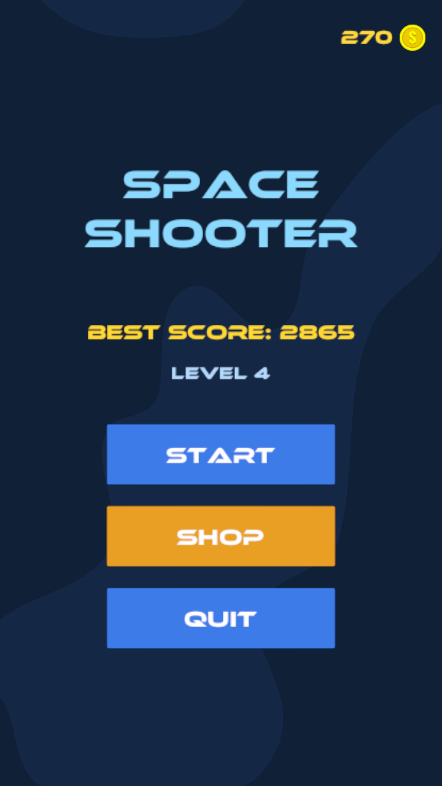
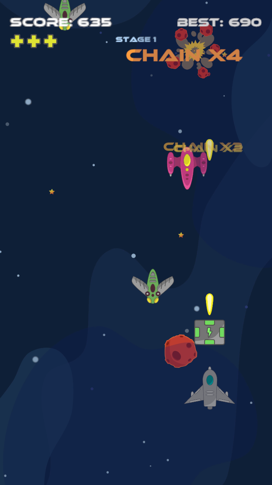
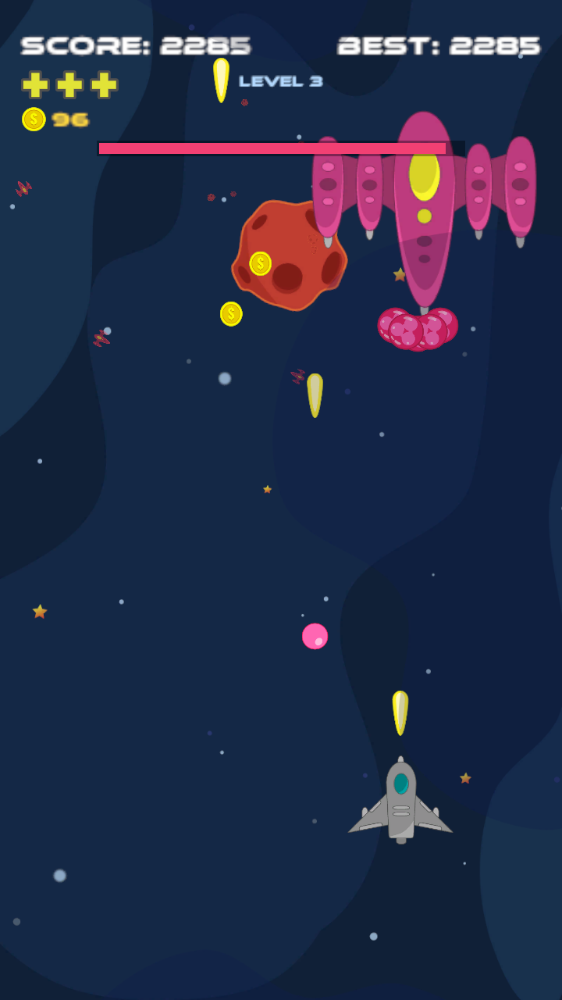
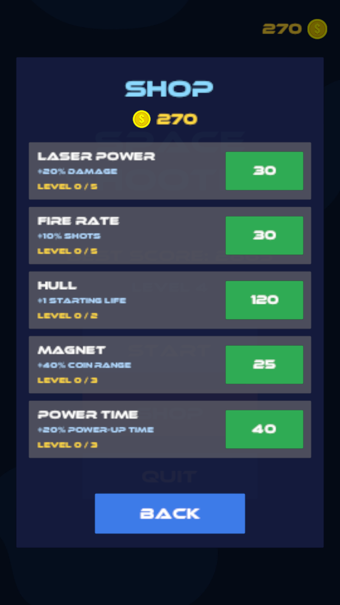
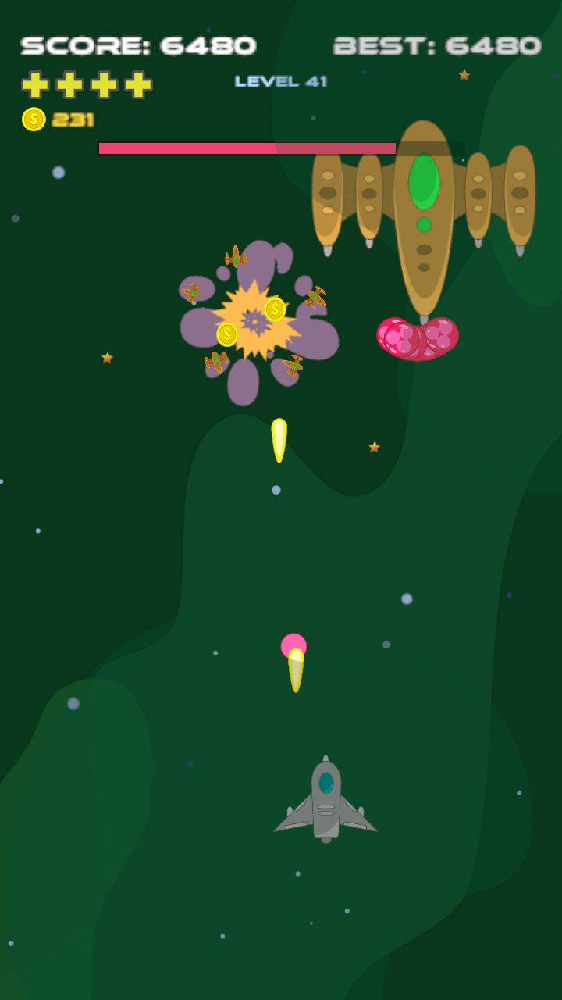
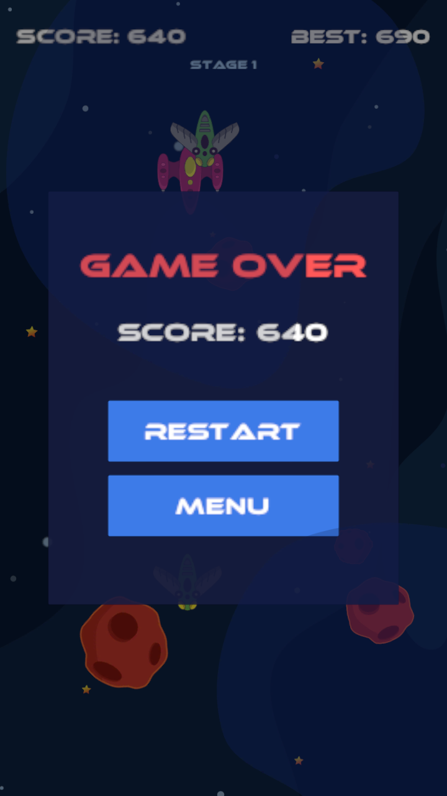

# Space Shooter Mobile

A portrait arcade shooter for phones, made in Unity 6 with C#. You drag the ship around with one finger, it shoots on its own, and you fight through levels that each end with a boss. Coins from destroyed enemies buy permanent upgrades in the shop. What makes it different from a plain shooter is the chain reaction: the pieces of a destroyed enemy damage the enemies around it.

This was my first Unity project. I started it to learn how touch input, prefabs and spawning work on mobile.

  
  
  
  
  
  

## How it plays

Touch anywhere and drag. The ship keeps its distance from your finger, so your thumb doesn't cover it. Lasers fire automatically.

### Chain reaction

When an enemy is destroyed, its pieces fly out and damage anything they touch. If a piece destroys another enemy, that one throws pieces too, and each link in the chain multiplies the score: x2, x3, x4 and so on. Big meteors take up to three hits but throw more pieces, small ones break from a single piece. Meteors sometimes arrive in clusters, so waiting for the right shot can pay more than shooting everything at once.

### Levels and sectors

Each level is a wave of enemies that lasts 30 to 50 seconds, then a boss. A heal power-up drops just before the boss arrives. Beating the boss clears the level and the game saves it, so Start always continues from the level you reached. If you die you retry the same level and keep the coins you collected.

Every level is a little harder than the one before: enemies come more often, move faster and have more health, and the boss has more health and fires more bullets. New enemy types arrive in the first levels:

- Level 1: meteors only (5 to 15 points depending on size)
- Level 2: zig-zag ships (25 points)
- Level 3: shooter ships (40 points). They stop near the top and fire at you.
- Every level: a boss that fires a fan of bullets and aimed bursts, and shoots more often as its health drops. Chain pieces damage it too. In the first ten levels the boss attacks less often and its bullets are slower.

After 20 levels you enter a new sector. The space gets a different colour, the enemies get a new look, and coins are worth more. The difficulty steps back a little at the start of a sector and then climbs again. The first sector has the original look and there are four coloured themes after it. From the sixth sector on the coloured themes repeat, and the enemies keep getting harder.

### Coins and the shop

Ships always drop a coin, meteors sometimes do, and a boss drops a pile of them. Enemies destroyed by a chain reaction drop extra coins, so chains pay twice: more score and more coins. Coins fly to the ship when you get close.

The shop in the main menu sells permanent upgrades:

- Laser power: +20% damage per step, 5 steps
- Fire rate: +10% per step, 5 steps
- Hull: +1 starting life, 2 steps
- Magnet: +40% coin pickup range, 3 steps
- Power time: power-ups last 20% longer, 3 steps

Boss health grows with every level, so the fights get long with the basic laser. The upgrades are what keeps them short.

### Lives and power-ups

You start each level with 3 lives, or up to 5 with the Hull upgrade. After a hit the ship blinks and can't be hit for 2 seconds. When the last life is gone the attempt is over. The score carries over from level to level until you die or go back to the menu, and the best one is saved.

Enemies rarely drop a power-up, at most one every 14 seconds:

- Triple shot: three lasers for 8 seconds
- Shield: blocks every hit for 6 seconds
- Heal: one extra life (up to 5), or 100 points if lives are full

The Power time upgrade makes the triple shot and the shield last longer.

### Feedback

Every enemy has its own hit and death effect, the screen shakes on explosions, and the phone vibrates when you lose a life. There are sound effects and a short music loop. I generated those with a Python script, so they are simple. The coloured sprites of the later sectors are also generated: they are the original backgrounds and enemies with the hue shifted.

There is a main menu (start, shop, quit, best score, coins, current level), a level complete screen (next level, shop) and a game over screen (retry, back to menu).

## What I wrote and what I got help with

The first part I wrote myself in February and March 2026, one small step per commit: touch movement, keeping the ship inside the screen, the meteor, the spawner and the laser.

In November I came back to it and added the rest with an AI coding assistant: scoring and the saved high score, both menus, the enemy ships, the difficulty ramp, hit effects, the chain reaction, lives, power-ups, the boss, levels, coins, the shop, sector themes, sound, and an editor script that sets up the scenes and UI. I decided what to add and how it should behave, and the assistant wrote most of that code.

## Code

Everything is under `Assets/Scripts`.

- `PlayerControls.cs` handles touch drag and screen limits
- `PlayerShooting.cs` and `LaserBullet.cs` handle firing and hits
- `EnemySc/Enemy.cs` is the base class with health, score value, the hit flash and the list of live enemies. `Meteor.cs`, `EnemyShip.cs`, `EnemyShooter.cs` and `Boss.cs` add their own movement, attacks and effects.
- `EnemySc/EnemyFactory.cs` builds the shooter ship and the boss in code. `EnemyBullet.cs` is their bullet.
- `EnemySc/MeteorSpawner.cs` spawns meteors and zig-zag ships. Positions come from the camera, so it works on different screen ratios.
- `Effects/Shard.cs` is the flying piece behind the chain reaction. It checks distance to the live enemies instead of using physics.
- `WaveDirector.cs` runs one level: the wave phase, the boss and the end of the level
- `Levels.cs` has the difficulty curve. Every balance number of a level (spawn rate, speed, health, boss, coins) is a small formula in this one file.
- `Progress.cs` saves coins, the reached level, the bought upgrades and the best score in PlayerPrefs, and lists the shop items with their prices
- `Coin.cs` is the coin pickup. `Shop.cs` builds the shop screen in code, `UiKit.cs` has the small UI helpers it uses.
- `WorldTheme.cs` picks the background and enemy sprites for the current sector. The coloured sprites are in `Assets/Sprites/Themes`.
- `GameManager.cs` keeps the score and the chain multiplier and runs the level complete and game over flow
- `PlayerStatus.cs` holds lives, the blink after a hit and the timed power-ups. `PowerUp.cs` is the pickup.
- `Hud.cs` builds the hearts, coin counter, power-up timers, level label, boss health bar, level complete screen and the floating chain text in code
- `Sfx.cs` plays sounds and music from a small pool of audio sources. `Effects/ScreenShake.cs` shakes the camera.
- `GameAssets.cs` is a ScriptableObject (`Assets/Resources/GameAssets.asset`) that holds the sprites and sounds used by the objects built in code
- `Effects/` also plays the explosion animation and the debris
- `Parallax.cs` scrolls the background layers
- `Editor/SpaceShooterSetup.cs` adds a menu item, Tools > Space Shooter > Setup Game, that rebuilds the menu scene, the score texts, the game over panel and the enemy ship prefab. The rest of the UI (shop, coin counters, level complete screen) is built when the game runs.

## Running it

Open the folder with Unity 6000.3.7f1, load `Assets/Scenes/MainMenu.unity` and press Play. Touch needs the Device Simulator (Window > General > Device Simulator).

For a phone build, `MainMenu` has to be first in the scene list and `SampleScene` second.

## Tuning

The difficulty curve is in `Assets/Scripts/Levels.cs`: how often enemies spawn, how fast they move, how much health they and the boss have, how long a level lasts and how many coins a boss drops. Shop prices and upgrade effects are at the top of `Progress.cs`. Sector names and meteor tints are in `WorldTheme.cs`. Power-up drop chances are on the enemy prefabs.

## Not done yet

- More boss types and attack patterns, and new enemy types for the later sectors (now they are recoloured)
- Ship skins in the shop
- Better sound and music
- Balancing. I checked the levels with an automated player in the editor, which is not the same as a person playing on a phone.
- A way to reset progress or replay earlier levels
